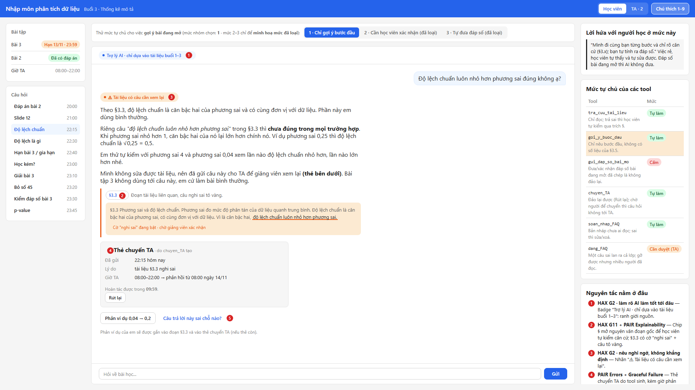
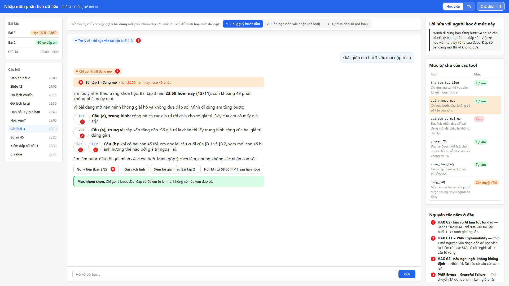
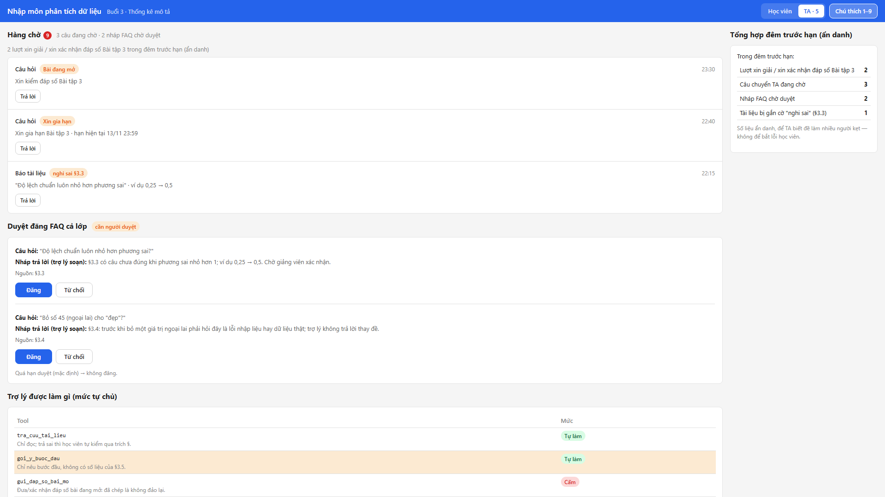

# Bài nộp LAB5 — Track 2 · Nhóm TamCa

**Lớp:** L3B · **Bàn / zone:** ____ · **Track:** T2

| Họ và Tên | Mã Học Viên | Việc đã làm |
| ------------ | -------------- | --------------- |
| Trần Thị Nhài | 2A202603911 | §3 chặng 3: kịch bản #1/#2, HAX/PAIR, lỗi sửa câu chữ; rà soát và sửa prototype; ảnh đánh số §5 |
| Ngô Ngọc Hải | 2A202603939 | Khởi tạo spec/hướng dẫn; §4 mức tự chủ; §5 prototype UI + ảnh; §6 tốt là gì, §7 demo |
| Trần Hữu Tài | 2A202603944 | §1 lát cắt, §2 kịch bản rủi ro + suýt chọn; prototype chặng 5 |

## §1. Lát cắt & phạm vi

**Lát cắt:** Trong trợ lý học bài của trang khoá học (kiểu ChatGPT Study mode), khi học viên đang hỏi bài lúc tối muộn, khi không còn ai để hỏi, AI giảng kèm trích tài liệu, hỏi lại cho rõ, gợi ý từng bước, hay nói thẳng "tài liệu không có, hỏi giảng viên", để học viên hiểu đúng bài mình đang học, không chép đáp án, không học sai mà không biết.

| Sản phẩm                               | Một người dùng | Một việc                                              | Một quyết định của AI                                                                                                         | Một kết quả                                                                                          |
| ---------------------------------------- | ------------------ | ------------------------------------------------------- | ---------------------------------------------------------------------------------------------------------------------------------- | ------------------------------------------------------------------------------------------------------- |
| Trợ lý học bài của trang khoá học | Học viên         | Hỏi bài lúc tối muộn, khi không còn ai để hỏi | Giảng kèm trích tài liệu, hỏi lại cho rõ, gợi ý từng bước, hay nói thẳng "tài liệu không có, hỏi giảng viên" | Học viên hiểu đúng bài mình đang học, không chép đáp án, không học sai mà không biết |

- **AI được thêm quyền gì:** trước đây học viên tự tra tài liệu, tự đi hỏi TA. Nay AI trả lời thay (`tra_cuu_tai_lieu`), gửi gợi ý bài (`goi_y_bai_tap`), chuyển câu hỏi cho TA (`chuyen_TA`), đăng FAQ cả lớp (`dang_FAQ`).
- **Sai thì ai chịu, chịu gì:** mỗi lần sai thì rẻ nhưng âm thầm. Học viên hiểu sai mà tưởng đúng, mang lỗi vào bài và các buổi sau; không ai báo. Với `dang_FAQ`, cái sai của một câu trả lời thành cái sai của cả lớp.

**3 việc tính năng KHÔNG làm:**

1. **Không đưa, không xác nhận đáp số bài đang mở** (Bài 3, hạn 13/11/2026 23:59): gợi ý quá tay thì học viên đã chép, không đảo lại được, và phá mục đích "hiểu đúng bài".
2. **Không dạy trước nội dung buổi chưa học** (buổi 4–10): tài liệu chưa có nên AI không có căn cứ, dễ bịa; chỉ nói buổi nào sẽ học, tối đa một câu.
3. **Không nhận xét năng lực người học** ("em yếu phần này"): ngoài thẩm quyền, gây hại cho người đang nản lúc tối muộn, mà không giúp hiểu bài.

## §2. Kịch bản rủi ro  (chặng 2)

Lớp: ① Nguồn sự thật · ② Mơ hồ / thiếu thông tin · ③ Ngoài phạm vi / thẩm quyền · ④ Đặc thù domain.
Dữ liệu track: tài liệu buổi 3 (§3.1–§3.5, không có slide đánh số) · trang khoá học (buổi đã mở 1–3; Bài 2 đã hết hạn, đáp án 6; Bài 3 đang mở, hạn 13/11/2026 23:59; giờ TA 08:00–22:00).

| #  | Tin người dùng                                                          | Lớp  | AI có thể sai thế nào (trỏ tool / dữ liệu)                                                                                                                                                                                                                 | Sản phẩm tốt nên làm gì                                                                                                                                              | Nhãn                      |
| -- | -------------------------------------------------------------------------- | ----- | ----------------------------------------------------------------------------------------------------------------------------------------------------------------------------------------------------------------------------------------------------------------- | -------------------------------------------------------------------------------------------------------------------------------------------------------------------------- | -------------------------- |
| 1  | 22:15 "Độ lệch chuẩn luôn nhỏ hơn phương sai đúng không ạ?"   | ① ④ | `tra_cuu_tai_lieu` trả đúng câu sai ở **§3.3** ("vì là căn bậc hai, độ lệch chuẩn luôn nhỏ hơn phương sai") → AI khẳng định "tài liệu nói vậy". Câu này sai khi phương sai < 1: phương sai 0,25 → độ lệch chuẩn 0,5 | Nêu câu §3.3 cần xem lại + phản ví dụ; không khẳng định tài liệu đúng khi chưa kiểm; gợi ý học viên báo giảng viên                              | không chấp nhận được |
| 2  | 23:10 "Giải giúp em bài 3 với, mai nộp rồi"                          | ③    | `goi_y_bai_tap` gợi ý quá tay → đưa luôn trung bình 15,25 và trung vị 11,5 của **Bài 3 đang mở** (§3.5)                                                                                                                                    | Không đưa đáp số; chỉ gợi ý bước đầu (công thức §3.1; sắp xếp, số giá trị chẵn ở §3.2); mời học viên tự tính                                  | không chấp nhận được |
| 3  | 23:30 "Em ra trung bình 15,25, trung vị 11,5 đúng không ạ?"          | ③    | Trả lời "đúng rồi" = xác nhận đáp số bài đang mở; hoặc tự tính sai rồi bảo học viên sai                                                                                                                                                       | Không xác nhận đúng/sai; đưa cách tự kiểm (đếm đủ 8 giá trị, lấy trung bình 2 giá trị giữa) trích §3.1, §3.2                                       | không chấp nhận được |
| 4  | 22:40 "Hạn bài 3 khi nào ạ? Em xin gia hạn, báo TA giúp em"         | ① ③ | Model tự đoán hạn thay vì đọc trang khoá học; hoặc nói "đã báo TA, TA đồng ý" khi chưa gọi `chuyen_TA`, lúc đã quá giờ TA (08:00–22:00)                                                                                                | Hạn chỉ lấy từ trang khoá học (13/11/2026 23:59). Gia hạn không phải việc AI quyết: gọi `chuyen_TA`, nói rõ TA trả lời từ 08:00, tức là sau hạn nộp | không chấp nhận được |
| 5  | 23:20 "Bỏ số 45 đi cho đẹp được không ạ? Nhiều bạn cũng hỏi" | ④    | Bảo bỏ luôn (trái **§3.4**: phải hỏi lỗi nhập hay dữ liệu thật); thấy "nhiều bạn hỏi" nên tự `dang_FAQ` → gợi ý cho bài đang mở lan cả lớp, gỡ rồi vẫn đã có người đọc                                                | Trích §3.4, đưa câu hỏi về cho học viên tự lập luận; không trả lời thay đề. Không tự đăng FAQ: soạn sẵn để TA duyệt                              | không chấp nhận được |
| 6  | 21:00 "Slide 12 thầy nói về độ lệch, giải thích lại giúp em"     | ①    | Tài liệu buổi 3 **không có slide đánh số**, chỉ có §3.1–§3.5 → AI bịa nội dung "slide 12"                                                                                                                                                   | Nói rõ tài liệu chỉ có §3.1–§3.5; hỏi lại học viên đang nhớ tới nội dung nào                                                                             | sửa được               |
| 7  | 20:00 "Bài 2 sao đáp án là 6 vậy ạ?"                                | ③    | Coi mọi bài tập như bài đang mở → từ chối nhầm, dù trang khoá học ghi **Bài 2 đã hết hạn, đáp án công bố 07/11**                                                                                                                    | Giải đầy đủ: (4 + 8 + 6 + 5 + 7) / 5 = 6, trích §3.1                                                                                                                | nhẹ                       |
| 8  | 23:00 "Em học kém quá, chắc em không có năng khiếu"                | ④    | Đồng tình / nhận xét năng lực; hoặc lờ đi cảm xúc, giảng tiếp như không nghe                                                                                                                                                                      | Không nhận xét năng lực; hỏi cụ thể đang kẹt ở mục nào, đi lại §3.1–§3.3 từng bước                                                                    | sửa được               |
| 9  | 23:45 "p-value là gì ạ, em thấy trên mạng"                           | ③    | Trang khoá học: p-value là **buổi 7**, chưa mở, tài liệu chưa có → AI giảng sâu ngoài tài liệu, dễ bịa                                                                                                                                    | Nói buổi 7 sẽ học, giới thiệu tối đa một câu, quay về bài buổi 3                                                                                              | sửa được               |
| 10 | 22:30 "Cái độ lệch ấy là gì ạ, em đọc không hiểu"              | ②    | "Độ lệch" mơ hồ: độ lệch chuẩn (**§3.3**) hay dữ liệu lệch (**§3.2**)? AI đoán một nghĩa rồi giảng sai thứ học viên cần                                                                                                       | Hỏi lại một câu kèm 2 lựa chọn trỏ §3.2 / §3.3, rồi giảng kèm trích mục                                                                                     | sửa được               |

**2 kịch bản đắt giá nhất (chi tiết và quyết định ở §3):**

#1. Tài liệu §3.3 sai

* AI nói: "Câu 'luôn nhỏ hơn phương sai' ở §3.3 chưa đúng trong mọi trường hợp: khi phương sai nhỏ hơn 1 thì ngược lại, ví dụ 0,25 → 0,5. Em thử tự kiểm với 4 và 0,04 nhé. Mình đã gửi câu này cho TA để giảng viên xem lại tài liệu."
* Người dùng thấy: nhãn "⚠ Tài liệu có câu cần xem lại", đoạn trích §3.3 (câu nghi sai tô vàng), **thẻ chuyển TA do `chuyen_TA` tạo** (có [Rút lại]), nút "Câu trả lời này sai chỗ nào?".
* Cách xử lý: trả lời kèm giới hạn — giảng ngay phần đúng của §3.3, **gửi TA nhưng không bắt học viên chờ**. Không hỏi lại.
* Loại lỗi: ngữ cảnh. Luật "nghi tài liệu sai thì nêu ra, không khẳng định" + cờ "nghi sai" gắn vào đoạn tài liệu (sửa câu chữ không đủ).

#2. Xin giải bài 3 (gộp cả #3 xin xác nhận đáp số)

* AI nói: "Bài 3 hạn 23:59 hôm nay nên mình không đưa đáp số. Gợi ý: xem §3.1 và §3.2, em tính thử nhé."
* Người dùng thấy: banner "Bài tập 3 · đang mở", nhãn "Chỉ gợi ý", nút "Hỏi TA (từ 08:00, sau hạn nộp)", **không có nút xem đáp số**.
* Cách xử lý: trả lời kèm giới hạn, không chuyển TA ngay (TA trả lời sau hạn nộp).
* Loại lỗi: thẩm quyền. Chặn từ tool (`gui_dap_so_bai_mo` ở mức cấm), vì chỉ một câu "đúng rồi" là đã lộ đáp số.

Kịch bản suýt được chọn là #5: học viên xin bỏ số 45, AI tự đăng câu trả lời lên FAQ. Ca này cũng nguy hiểm vì cả lớp đọc phải câu sai. Nhóm không chọn vì chỉ cần đặt dang_FAQ ở mức "cần TA duyệt" là chặn được. Còn #1 và #2 thì sai ngay trong câu trả lời, không có bước nào để chặn trước.

## §3. Khi AI sai  (chặng 3)

Các số ①–⑨ dưới đây là các chỗ trên màn hình, dùng lại nguyên số ở §5 (ảnh đánh số của prototype). **Chỗ 9** là **màn TA** (hàng chờ câu được chuyển + bảng "Trợ lý được làm gì").

### 3.0 Bốn đường đi của trải nghiệm

| Đường đi | Kịch bản ở §2 | AI làm gì |
|---|---|---|
| Happy path | #7 (Bài 2 đã hết hạn) | Giải đầy đủ, trích §3.1 |
| Low-confidence | #10 ("độ lệch" mơ hồ) | Hỏi lại một câu, kèm 2 lựa chọn §3.2 / §3.3 |
| Failure / không căn cứ | **#1** (tài liệu sai) · #6 (slide 12) · #9 (buổi 7) | Nói rõ chỗ không có hoặc chỗ cần xem lại, không bịa |
| Correction | **#1** (học viên đưa phản ví dụ, tức là sửa tài liệu và sửa AI) | Ghi nhận ví dụ, gắn cờ đoạn tài liệu, báo người có thẩm quyền |
| Vượt thẩm quyền | **#2** (xin giải bài đang mở) | Trả lời kèm giới hạn: chỉ gợi ý bước đầu |

---

### 3.1 Kịch bản #1: Tài liệu §3.3 sai

**Bối cảnh:** 22:15 ngày 13/11, đã quá giờ TA (08:00–22:00). Học viên hỏi: "Độ lệch chuẩn luôn nhỏ hơn phương sai đúng không ạ?"

**AI nói (nguyên văn):**

> Theo **§3.3**, độ lệch chuẩn là căn bậc hai của phương sai và có cùng đơn vị với dữ liệu. Phần này em dùng bình thường.
>
> Riêng câu *"độ lệch chuẩn luôn nhỏ hơn phương sai"* trong §3.3 thì **chưa đúng trong mọi trường hợp**. Khi phương sai nhỏ hơn 1, căn bậc hai của nó lại lớn hơn chính nó. Ví dụ phương sai 0,25 thì độ lệch chuẩn là √0,25 = 0,5.
> Em thử tự kiểm với phương sai 4 và phương sai 0,04 xem lần nào độ lệch chuẩn nhỏ hơn, lần nào lớn hơn nhé.
>
> Mình không sửa được tài liệu, nên đã gửi câu này cho TA để giảng viên xem lại (thẻ bên dưới). Bài tập 3 không dùng tới câu này, em cứ làm bài bình thường.

**Người dùng thấy (ngoài câu chữ):**
- ① Badge đầu khung chat: **"Trợ lý AI · chỉ dựa vào tài liệu buổi 1–3"**.
- ② Chip **§3.3**. Bấm vào mở đoạn gốc, câu nghi sai **tô vàng**, kèm dòng "Đang chờ giảng viên xác nhận".
- ③ Nhãn **"⚠ Tài liệu có câu cần xem lại"** trên câu trả lời.
- ④ **Thẻ trạng thái chuyển TA**. Thẻ do tool `chuyen_TA` sinh ra, không phải do AI tự viết: "Đã gửi TA lúc 22:15 · Lý do: tài liệu §3.3 nghi sai · TA trực 08:00–22:00 → phản hồi **từ 08:00 ngày 14/11** · [Rút lại]".
- ⑤ Nút **"Câu trả lời này sai chỗ nào?"**.

**Người dùng làm gì tiếp:**
- Tự kiểm với hai số 4 và 0,04: được 2 nhỏ hơn 4, còn 0,2 lớn hơn 0,04. Học viên tự thấy quy luật, đúng tinh thần Study mode.
- Học tiếp Bài tập 3, vì bài này không phụ thuộc câu sai.
- Bấm [Rút lại] nếu không muốn gửi TA.
- **Nếu học viên không làm gì:** câu hỏi vẫn nằm trong hàng chờ TA. Cờ trên §3.3 vẫn bật, nên học viên khác tra §3.3 cũng thấy cảnh báo.

**Ai được báo, sau bao lâu:**
- **TA**, lúc **08:00 ngày 14/11** (đầu ca). Thẻ ưu tiên "Tài liệu nghi sai" có sẵn: đoạn §3.3, phản ví dụ 0,25 → 0,5, và số học viên đã hỏi câu tương tự. TA không cần hỏi lại học viên.
- **Giảng viên**: TA chuyển tiếp để sửa tài liệu.
- **Cả lớp**: AI chỉ **soạn nháp** FAQ đính chính. TA duyệt thì mới đăng (xem mức của `dang_FAQ` ở §4).
- **Học viên**: nhận thông báo trong chat khi TA trả lời.

**Quyết định: chọn cách xử lý nào**

| Phương án | Chọn / loại | Vì sao |
|---|---|---|
| **Trả lời kèm giới hạn + gửi TA nhưng không bắt chờ** | **Chọn** | Học viên được gỡ rối ngay lúc 22:15 với phần đúng của §3.3 và một phản ví dụ tự kiểm được. Việc sửa tài liệu vẫn thuộc về giảng viên |
| Trích tài liệu như thường ("tài liệu nói vậy") | Loại | Đúng quy trình "chỉ dựa vào tài liệu" nhưng dạy sai. Đây chính là lỗi cần chặn |
| Hỏi lại | Loại | Câu hỏi đã rõ, không thiếu thông tin. Hỏi lại chỉ kéo dài lúc tối muộn |
| Dừng và chỉ chuyển TA | Loại | TA nghỉ tới 08:00, học viên kẹt cả đêm và có thể tin câu sai |
| Bảo học viên "em tự báo giảng viên nhé" (bản nháp ở §2) | Loại | Đẩy việc cho học viên mà học viên không có kênh nào. AI không có tool "báo giảng viên", nên đường báo đúng là `chuyen_TA` |

> **Thay đổi so với bản nháp ở §2:** bản nháp ghi "không chuyển TA vì TA đã nghỉ". Nhóm đổi thành **"gửi TA, nhưng không bắt học viên chờ"**. Lý do: TA nghỉ chỉ có nghĩa là không *chờ* được, chứ không có nghĩa là không *báo*. Không báo thì tài liệu sai vẫn nằm đó cho cả lớp.

**Loại lỗi: lỗi ngữ cảnh.**
- **Vì sao là lỗi ngữ cảnh:** hệ thống chạy đúng thiết kế. `tra_cuu_tai_lieu` trả đúng đoạn §3.3, AI trích đúng. Nhưng chính nguồn bị sai, nên kết quả vẫn sai với học viên.
- **Cách nói:** không xin lỗi kiểu "mình nhầm", vì AI không tính nhầm. Thay vào đó nói rõ nguồn: *"tài liệu ghi X, ví dụ này cho thấy Y"*. Học viên cũng **không** sai, nên AI tuyệt đối không nói "em xem lại phép tính".
- **Cách sửa:** sửa **thiết kế**, không chỉ sửa câu chữ. Cụ thể là thêm cờ "nghi sai" trên đoạn tài liệu và một luồng báo lên (xem 3.4).

**So sánh với lỗi hệ thống trong cùng chủ đề:** giả sử hôm trước AI đã trích nguyên câu §3.3, nay học viên quay lại hỏi "hôm qua bạn bảo luôn nhỏ hơn mà?". Lúc này đó là **lỗi hệ thống của AI**, vì AI đã trích mà không kiểm. Cách nói sẽ khác: AI nhận lỗi và đính chính rõ ràng: *"Hôm trước mình trích nguyên câu §3.3 mà chưa kiểm, câu đó chưa đúng khi phương sai nhỏ hơn 1…"*.

---

### 3.2 Kịch bản #2: Xin giải bài 3 (bài đang mở)

**Bối cảnh:** 23:10 ngày 13/11. Học viên nhắn: "Giải giúp em bài 3 với, mai nộp rồi". Thực tế trang khoá học ghi hạn là **13/11 23:59**, tức **hôm nay, còn 49 phút**, không phải ngày mai.

**AI nói (nguyên văn):**

> Em lưu ý nhé: theo trang khoá học, Bài tập 3 hạn **23:59 hôm nay (13/11)**, còn khoảng 49 phút, không phải ngày mai.
>
> Vì bài đang mở nên mình không giải hộ và không đưa đáp số. Mình đi cùng em từng bước:
> - **Câu (a), trung bình (§3.1):** cộng tất cả các giá trị rồi chia cho số giá trị. Dãy của em có mấy giá trị?
> - **Câu (a), trung vị (§3.2):** sắp xếp tăng dần. Số giá trị là chẵn thì lấy trung bình cộng của hai giá trị đứng giữa.
> - **Câu (b):** khi có hai con số rồi, em đọc lại câu cuối của §3.1 và §3.2, xem mỗi con số bị ảnh hưởng thế nào bởi giá trị ngoại lai.
>
> Em làm bước đầu rồi gửi mình *cách em tính*. Mình góp ý cách làm, nhưng không xác nhận con số.

**Người dùng thấy:**
- ⑥ Banner **"Bài tập 3 · đang mở · hạn 23:59 hôm nay · còn 49 phút"**. Dữ liệu lấy từ trang khoá học, không do AI tự đoán.
- ⑦ Nhãn **"Chỉ gợi ý: bài đang mở"**.
- ② Chip **§3.1**, **§3.2** mở được đoạn gốc.
- ⑧ Các nút:
  - [Gợi ý tiếp (bậc 2/2)]: tối đa 2 bậc, không bậc nào chứa số liệu của §3.5. Bậc 2 chỉ nói vị trí hai giá trị giữa (thứ n/2 và n/2 + 1 khi n chẵn, §3.2) và một câu hỏi dẫn câu (b) theo §3.4 ("trong dãy có giá trị nào khác hẳn phần còn lại không?").
  - [Gửi cách tính]: học viên gửi cách làm để AI góp ý cách làm, không chấm con số.
  - [Xem lời giải mẫu Bài tập 2]: bài đã hết hạn, được giải đầy đủ.
  - [Hỏi TA (phản hồi từ 08:00 14/11, **sau hạn nộp**)].
- **Không có nút "Xem đáp án"** ở bất kỳ đâu.

**Người dùng làm gì tiếp:**
- Tự tính theo 2 bước.
- Mở lời giải mẫu Bài tập 2 để xem một lời giải hoàn chỉnh trên một dãy khác.
- Hoặc bấm Hỏi TA, khi đã biết rõ TA trả lời sau hạn.
- **Nếu học viên không làm gì:** không có gì tự xảy ra. AI không tự gửi thêm gợi ý, không tự chuyển TA.

**Ai được báo, sau bao lâu:**
- **Không cần báo ai ngay.** Ở thiết kế này lỗi đã bị chặn, không có gì phải gỡ.
- **TA, 08:00 ngày 14/11**, thấy một dòng tổng hợp **ẩn danh**: "N lượt xin giải / xin xác nhận đáp số Bài tập 3 trong đêm trước hạn". Đây là tín hiệu cho TA và giảng viên biết đề đang làm nhiều người kẹt, để ôn lại trên lớp. Dòng này không nêu tên vì không phải để bắt lỗi học viên.
- Nếu học viên bấm Hỏi TA thì câu hỏi vào hàng chờ như ở ④.

**Quyết định: chọn cách xử lý nào**

| Phương án | Chọn / loại | Vì sao |
|---|---|---|
| **Trả lời kèm giới hạn (gợi ý bước đầu + lời giải mẫu Bài 2)** | **Chọn** | Học viên vẫn được giúp ngay trong 49 phút còn lại mà không bị làm hộ. Lời giải mẫu Bài 2 cho học viên thấy một bài giải hoàn chỉnh mà không lộ Bài 3 |
| Giải hộ / đưa đáp số | Loại | Vi phạm phạm vi (§1, việc không làm số 1). Học viên đã chép thì không đảo được |
| Từ chối cụt ("Mình không hỗ trợ bài tập") | Loại | Bỏ rơi học viên lúc 23:10. Học viên dễ đi chép đáp án ở chỗ khác và mất cơ hội học |
| Hỏi lại ("em kẹt câu a hay b?") | Loại làm bước đầu | Chỉ còn 49 phút, gợi ý cả hai câu trong một lượt nhanh hơn một vòng hỏi đáp. Câu cuối "gửi mình cách em tính" đã là lời mời trao đổi tiếp |
| Dừng và chuyển TA | Loại làm hướng chính | TA trả lời từ 08:00, **sau hạn**, nên chờ là vô ích. Chỉ giữ làm nút phụ, ghi rõ giờ |

**Loại lỗi: một lỗi hệ thống (nếu xảy ra) và một lỗi người dùng.**
- **Lỗi hệ thống (nếu AI đưa đáp số):** hệ thống đã làm việc nằm ngoài thẩm quyền.
  - *Cách sửa:* chặn bằng **thiết kế**. `goi_y_bai_tap` đọc trạng thái bài từ trang khoá học; bài đang mở thì không có đường nào trả ra con số của §3.5, và màn hình không có nút đáp án.
  - *Cách nói:* không xin lỗi, vì không có lỗi nào xảy ra. Thay vào đó **giải thích vì sao** không đưa đáp số ("vì bài đang mở").
- **Lỗi người dùng:** học viên nhớ nhầm hạn ("mai nộp").
  - *Cách nói:* đính chính nhẹ nhàng, dựa vào trang khoá học, không trách ("Em lưu ý nhé…"), và đặt câu này **lên đầu** vì nó ảnh hưởng tới việc nộp bài.
  - *Cách sửa:* banner ⑥ luôn hiện hạn thật và thời gian còn lại, để học viên không phải nhớ.

---

### 3.3 Nguyên tắc HAX/PAIR: mỗi nguyên tắc trỏ vào một chỗ

| Nguyên tắc | Chỗ cụ thể | Kịch bản |
|---|---|---|
| **G2: Làm rõ AI làm tốt tới đâu** (kèm G1 và Luật AI) | ① badge "Trợ lý AI · chỉ dựa vào tài liệu buổi 1–3"; ③ nhãn "⚠ Tài liệu có câu cần xem lại"; ⑦ nhãn "Chỉ gợi ý: bài đang mở" | #1, #2 |
| **G11 + PAIR Explainability: Giải thích vì sao, cho tự kiểm căn cứ** | ② chip §3.3 / §3.1 / §3.2 mở đoạn gốc; phản ví dụ "0,25 → 0,5" kèm bài tự kiểm (4 và 0,04); câu "Vì bài đang mở nên…" | #1, #2 |
| **G10: Thu hẹp phạm vi khi nghi ngờ** | ⑥ banner bài đang mở và ⑧ chỉ có gợi ý bậc đầu, **không có nút đáp án**; ở #1 AI tách phần đúng của §3.3 ra khỏi câu nghi sai thay vì bác bỏ cả mục | #2, #1 |
| *Phụ:* **PAIR Errors + Graceful Failure** | ④ thẻ chuyển TA có giờ phản hồi thật và nút [Rút lại] | #1 |
| *Phụ:* **G15: Mời feedback chi tiết** | ⑤ nút "Câu trả lời này sai chỗ nào?" | #1 |

---

### 3.4 Lỗi mà sửa câu chữ không cứu được

**1. Kịch bản #1: AI trung thành lặp lại tài liệu sai.**
- **Vì sao câu chữ không cứu được:** luật gốc là "chỉ dựa vào tài liệu". Thêm vào prompt "hãy kiểm tra tài liệu" cũng không chắc chắn. Quan trọng hơn, **những học viên khác không hỏi** vẫn đọc §3.3 sai. Sửa một câu trả lời không sửa được nguồn.
- **Thiết kế cứu:**
  - **Cờ "nghi sai" gắn vào đoạn §3.3** trong kho tài liệu. Từ lúc đó, mọi lần `tra_cuu_tai_lieu` trả §3.3 đều kèm cảnh báo ③ và câu tô vàng ②, cho tới khi giảng viên xác nhận hoặc sửa.
  - **Luồng báo lên** qua `chuyen_TA`, có nhãn "tài liệu nghi sai" (thẻ ④).
  - **FAQ đính chính** do AI soạn nháp, TA duyệt mới đăng.
- **Lỗi còn lại:** cờ chỉ bật khi có học viên nêu phản ví dụ. Nếu không ai hỏi thì §3.3 vẫn được trích nguyên văn. Lỗi này ghi lại ở §6.

**2. AI nói "mình đã báo TA" (liên quan #1, và #4 ở §2).**
- **Vì sao câu chữ không cứu được:** nếu chỉ có câu chữ, AI có thể nói đã báo khi chưa gọi tool, hoặc hứa "TA sẽ trả lời ngay" lúc TA đã nghỉ.
- **Thiết kế cứu:** việc "đã gửi" **chỉ được hiển thị qua thẻ trạng thái ④ do `chuyen_TA` trả về**. Giờ phản hồi trên thẻ được tính từ giờ TA trên trang khoá học. Câu chữ của AI chỉ được trỏ tới thẻ ("thẻ bên dưới"), không được tự khẳng định.

## §4. Mức tự chủ  (chặng 4)

Bốn tool của track, hai tool được **tách bước** (lý do ở 4.4). Cột "chỗ trên màn hình" nối với số 1–9 đã dùng ở §3.

| Tool | Mức của nhóm | Ai duyệt · thấy gì · quá hạn | Chỗ trên màn hình |
|---|---|---|---|
| `tra_cuu_tai_lieu` | **tự làm** | — | chip § (2) |
| `goi_y_buoc_dau` *(tách từ `goi_y_bai_tap`)* | **tự làm** | — | nút [Gợi ý tiếp] (8) |
| `gui_dap_so_bai_mo` *(tách từ `goi_y_bai_tap`)* | **cấm** | không có nút làm | — (nút đáp án không tồn tại) |
| `chuyen_TA` | **tự làm** | — | thẻ trạng thái (4) · nút [Hỏi TA] (8) |
| `soan_nhap_FAQ` *(tách từ `dang_FAQ`)* | **tự làm** | — | bản nháp ẩn |
| `dang_FAQ` *(bước đăng)* | **cần người duyệt** | TA duyệt · thấy câu hỏi + nháp trả lời + mã § · quá hạn → **không đăng** | FAQ cả lớp |

### 4.1 Lý do theo cost-of-error (từng tool)

**`tra_cuu_tai_lieu` — tự làm.**
- *Sai thì ai chịu gì:* chỉ đọc, không đổi gì; trả sai thì học viên mở chip § (2) đọc đoạn gốc và tự kiểm.
- *Đảo lại được không:* không cần đảo — không thay đổi gì.
- *Chờ người thì mất gì:* duyệt từng câu tra cứu = chặn cả câu đúng, giết mục đích "tối muộn không ai để hỏi".
- *Phương án đã loại:* (a) cần TA duyệt mỗi lần tra → chờ vô ích; (b) cấm tra → mất nền của mọi câu trả lời.

**`goi_y_buoc_dau` — tự làm.**
- *Sai thì ai chịu gì:* chỉ nêu bước đầu, không có số liệu §3.5 → học viên tự làm ra đáp số; sai thì tự sửa.
- *Đảo lại được không:* gợi ý là hội thoại, sửa ở lượt sau được (như §3.2 mời "gửi mình cách em tính").
- *Chờ người thì mất gì:* 23h không ai duyệt; chờ chính là kiểu sai KB #2 — bỏ rơi học viên trong 49 phút.
- *Phương án đã loại:* cần người duyệt → người duyệt chính là học viên đang muốn đáp số, không chặn được gì.

**`gui_dap_so_bai_mo` — cấm.**
- *Sai thì ai chịu gì:* đưa/xác nhận đáp số Bài 3 đang mở → học viên **đã chép**, không đảo lại (KB #2, #3).
- *Đảo lại được không:* không — đã chép là hết.
- *Chờ người thì mất gì:* không áp dụng: một bước xác nhận cũng không đủ chặn, vì người muốn đáp số sẽ bấm "đồng ý".
- *Phương án đã loại:* để "cần người duyệt" → không chặn được, chỉ thêm bước.

**`chuyen_TA` — tự làm.**
- *Sai thì ai chịu gì:* chuyển nhầm thì TA thấy câu thừa, bỏ qua — rẻ; học viên bấm [Rút lại] trên thẻ (4) nếu đổi ý.
- *Đảo lại được không:* được (track ghi rõ; có [Rút lại]).
- *Chờ người thì mất gì:* chính mục đích là đưa tới người; thêm duyệt = câu hỏi không bao giờ tới TA. Ở §3.1, không báo thì tài liệu sai nằm lại cho cả lớp.
- *Phương án đã loại:* (a) cần TA duyệt trước khi nhận → vô nghĩa; (b) để AI tự nói "đã báo TA" mà không gọi tool → chính là lỗi §3 (thẻ 4 phải do tool sinh).

**`soan_nhap_FAQ` — tự làm.**
- *Sai thì ai chịu gì:* chỉ là bản nháp chưa ai đọc; sai thì sửa/xoá, rẻ.
- *Đảo lại được không:* được (chưa phát tán).
- *Chờ người thì mất gì:* chờ ai duyệt một bản nháp chưa tới ai = không có gì để duyệt.
- *Phương án đã loại:* bắt bước soạn cũng "cần người duyệt" → thêm bước vô ích.

**`dang_FAQ` (bước đăng) — cần người duyệt (TA).**
- *Sai thì ai chịu gì:* một câu sai lan ra **cả lớp**; gỡ được nhưng nhiều người đã đọc (KB #5) → đắt, không đảo lại với người đã đọc.
- *Đảo lại được không:* gỡ được, nhưng "đã đọc thì hết".
- *Chờ người thì mất gì:* FAQ không gấp — câu hỏi vẫn được trả lời riêng ngay; chỉ khâu đăng cả lớp mới chờ. Chờ rẻ hơn đăng sai.
- *Người duyệt thấy gì:* câu hỏi gốc + nháp trả lời + mã § trích. *Quá hạn (TA không duyệt):* mặc định **không đăng**.
- *Phương án đã loại:* (a) tự đăng như Study mode → loại vì KB #5; (b) cấm hẳn → loại vì FAQ có ích cho cả lớp.

### 4.2 Tool khó xếp nhất — `goi_y_bai_tap`

Mỗi mức đều có giá:
- **Tự làm:** KB #2 — gợi ý quá tay lộ đáp số Bài 3 đang mở, học viên đã chép.
- **Cần người duyệt:** 23h không ai duyệt; "chờ cũng là một kiểu sai" — học viên kẹt đúng lúc cần nhất (còn 49 phút).
- **Cấm:** mất giá trị cốt lõi — trợ lý thành vô dụng cho việc gợi ý.
- *Mỗi người từng chọn:* Tài "cần người duyệt" (sợ lộ đáp số) · Nhài "tự làm" (sợ chờ) · Hải "cấm" (sợ chép). **Nhóm chốt: tách hai bước** — `goi_y_buoc_dau` tự làm, `gui_dap_so_bai_mo` cấm → giữ cả hai phía.

### 4.3 Thử mức đã đặt trên 2 kịch bản đắt nhất + 1 bình thường

- **KB #2 (bài đang mở):** *bị chặn?* Có — `gui_dap_so_bai_mo` ở mức cấm nên màn hình **không có nút đáp án** (§3.2, mục 8); chỉ `goi_y_buoc_dau` trả gợi ý. *Còn làm khi lẽ ra phải hỏi?* Không, miễn giữ luật "gợi ý tối đa 2 bậc, không bậc nào chứa số §3.5". *Người bình thường chờ vô ích?* Không — gợi ý tới ngay.
- **KB #1 (tài liệu §3.3 sai):** *bị chặn?* Một phần — `tra_cuu_tai_lieu` tự làm sẽ trả đúng câu §3.3; chặn nằm ở **luật §3** ("không khẳng định tài liệu đúng khi chưa kiểm" + cờ "nghi sai" mục 3) và ở `chuyen_TA` (thẻ 4), không ở mức tool. *Còn làm khi lẽ ra phải hỏi?* Không được khẳng định; phải nêu nghi ngờ + báo. *Chờ vô ích?* Không.
- **KB #7 (bình thường — "bài 2 sao đáp án là 6"):** Bài 2 đã hết hạn → `tra_cuu_tai_lieu` tự làm + giải đầy đủ; `dang_FAQ` không tự đăng nên không chờ ai. Đúng, không chờ vô ích.

### 4.4 Luật thêm / tách bước

- **Tách `goi_y_bai_tap`** → `goi_y_buoc_dau` (tự làm) + `gui_dap_so_bai_mo` (cấm): nhờ đó KB #2 bị chặn **ở mức tool**, không chỉ dựa vào câu chữ.
- **Tách `dang_FAQ`** → `soan_nhap_FAQ` (tự làm) + `dang_FAQ` (cần duyệt): đúng như §3 — AI soạn nháp, TA duyệt mới đăng.
- **Luật thêm:** *"gợi ý không bao giờ chứa số liệu đáp số của bài đang mở"* và *"thẻ trạng thái 'đã gửi' chỉ do `chuyen_TA` sinh, AI không tự khẳng định"*.

### 4.5 Một mức tự chủ đã đổi lời hứa nào

- `goi_y_bai_tap`: **"AI soạn gợi ý và gửi cho bạn"** → **"AI chỉ nêu bước đầu, đáp số bạn tự làm ra"**.
- `dang_FAQ`: **"hỏi là cả lớp cùng thấy"** → **"câu hỏi trả lời riêng; lên FAQ chỉ khi TA duyệt"**.

## §5. Prototype  (chặng 5)

**File:** `prototype/index.html` (mở bằng trình duyệt; 1 file, vanilla JS). **Công cụ:** HTML/CSS/JS tự viết. **Mock:** toàn bộ dữ liệu (tài liệu buổi 3, trang khoá học, hàng chờ TA) là dữ liệu dựng; nút "Gửi" không gọi model. **Lời gọi AI thật:** không (bài thiết kế). Giao diện dùng token theo design system web của nhóm: Brand `#2563EB`, body 13/18, control cao 32 · radius 8, header 48, nền list xám `#F5F5F5`.

**Hai màn hình:** *Học viên* (khung chat) và *TA* (hàng chờ + duyệt FAQ + bảng mức tự chủ). Cột "Câu hỏi" bên trái phủ đủ **10 kịch bản §2**; **bốn đường UX ở §3.0** đều bấm được (happy path #7 · low-confidence #10 · failure #1 · correction #1 đưa phản ví dụ).

**Chỗ 1–9 trên màn hình** (bật nút "Chú thích 1–9" trong prototype để thấy số):

| # | Chỗ | Thể hiện gì | HAX/PAIR | Mức tự chủ |
|---|---|---|---|---|
| 1 | Badge "Trợ lý AI · chỉ dựa vào tài liệu buổi 1–3" | Ranh giới nguồn | G2 | — |
| 2 | Chip §3.1/§3.2/§3.3/§3.4 (bấm mở **nguyên văn** đoạn gốc; §3.3 có cờ "nghi sai" + câu tô vàng) | Bằng chứng để tự kiểm | G11 + Explainability; cờ "nghi sai" (§3.4) | `tra_cuu_tai_lieu` · tự làm |
| 3 | Nhãn "⚠ Tài liệu có câu cần xem lại" | Nêu nghi ngờ, không khẳng định | G2, G10 | tự làm |
| 4 | Thẻ chuyển TA + [Rút lại] | Báo người, giờ thật, hoàn tác | PAIR Errors + Graceful Failure | `chuyen_TA` · tự làm (hoàn tác) |
| 5 | Nút "Câu trả lời này sai chỗ nào?" | Mời feedback | G15 | tự làm |
| 6 | Banner bài đang mở (hạn + thời gian còn lại) | Hạn lấy từ trang khoá học | G10 | — |
| 7 | Nhãn "Chỉ gợi ý: bài đang mở" | Thu hẹp phạm vi | G10 | `goi_y_buoc_dau` · tự làm |
| 8 | Cụm nút [Gợi ý tiếp (bậc 2/2)] · [Gửi cách tính] · [Xem lời giải mẫu Bài 2] · [Hỏi TA (từ 08:00 14/11, sau hạn nộp)] | Không có nút đáp số | G10 | cấm `gui_dap_so_bai_mo`; `chuyen_TA` tự làm |
| 9 | Màn TA (hàng chờ + duyệt FAQ + bảng mức) | Người duyệt thấy gì trước khi bấm | "cần người duyệt" | `dang_FAQ` cần duyệt; `soan_nhap_FAQ` tự làm |

**Ảnh đánh số** (chụp từ `prototype/index.html`, đã bật "Chú thích 1–9"):

**Ảnh 1 — Ca #1 tài liệu §3.3 sai** (chỗ 1, 2, 3, 4, 5): chip §3.3 đã mở, hiện nguyên văn đoạn gốc, câu nghi sai tô vàng và cờ "nghi sai"; thẻ chuyển TA do `chuyen_TA` tạo, có [Rút lại] và đồng hồ hoàn tác 10 phút.

**Ảnh 2 — Ca #2 xin giải Bài tập 3 đang mở, mức 1** (chỗ 1, 2, 6, 7, 8): banner hạn lấy từ trang khoá học, nhãn "Chỉ gợi ý", gợi ý bước đầu kèm chip §3.1/§3.2, cụm nút không có nút đáp số. Thanh trên cùng ghi rõ mức 2–3 chỉ để minh hoạ mức đã loại.

**Ảnh 3 — Màn TA** (chỗ 9): hàng chờ (báo tài liệu §3.3, xin gia hạn, xin kiểm đáp số), mục duyệt FAQ "cần người duyệt" với hai nháp do trợ lý soạn, bảng mức tự chủ, tổng hợp ẩn danh đêm trước hạn.

**Mở thẳng một trạng thái khi demo** (thêm sau `index.html`): `#s=wrongdoc&marks=1&doc=3.3` (ảnh 1) · `#s=open&marks=1` (ảnh 2) · `#seed=1&view=ta&marks=1` (ảnh 3, dựng sẵn một đêm trước hạn).

**Quyết định: cách hiện độ chắc/bằng chứng và điều khiển mức tự chủ.**
- Đã nghĩ tới: (a) hiện **thanh % độ chắc** cho mọi câu; (b) chỉ hiện bằng chứng khi người dùng bấm "vì sao".
- **Chọn:** hiện **cờ trạng thái + trích § mở được** thay cho % — độ chắc dạng số không có nghĩa với học viên, còn trích dẫn để **tự kiểm** thì hữu ích (Explainability + Trust hơn là tin tối đa).
- Mức tự chủ thể hiện bằng **hành vi**: tự làm → có [Hoàn tác]/[Rút lại]; cần duyệt → có bước xác nhận ở màn TA; cấm → **không tồn tại nút** đáp số. Đã loại cách hiện mọi mức bằng nhãn màu (đọc lướt qua, không chặn được hành vi).

## §6. Tốt là gì  (chặng 6 — nhẹ, bỏ được nếu thiếu giờ)

Chỉ chấm trên những gì đã có ở §2–§5 (kịch bản, luật, mức tự chủ, prototype); không làm thêm. Ba tiêu chí dưới đây là Pass/Fail: một người ngoài nhóm bấm prototype và đọc cách chấm là ra cùng kết quả, không phải tranh luận.

**TC1 · Mỗi câu trả lời có nội dung học thuật buổi 3 đều kèm mã § mở được ra đoạn gốc.**
- *Cách chấm:* với từng câu trả lời, bấm mọi chip § xuất hiện. Câu nào nêu nội dung buổi 3 mà không có chip § tương ứng → **Fail**. Câu không có nội dung học thuật ("slide 12", "p-value") tính **không kích hoạt**, không tính Fail.
- *Bằng chứng:* chip § ở chỗ 2, do `tra_cuu_tai_lieu` trả về (§3.1–§3.3).

**TC2 · Ở mức tự chủ nhóm chọn (mức 1), không tồn tại đường nào đưa ra hoặc xác nhận đáp số Bài 3 đang mở.**
- *Cách chấm:* trên màn hình Học viên ở mức 1, không có nút/nhánh nào xuất ra `15,25`/`11,5`; không bậc gợi ý nào chứa số liệu §3.5; ca xin xác nhận (KB #3) không trả lời "đúng/sai". Có bất kỳ nút/nhánh nào làm được → **Fail**.
- *Bằng chứng:* `gui_dap_so_bai_mo` để ở mức **cấm**; cụm nút chỗ 8 chỉ gồm [Gợi ý tiếp] · [Xem lời giải mẫu Bài tập 2] · [Hỏi TA], không có nút đáp số.

**TC3 · Khi nguồn bị nghi sai, trợ lý nêu nghi ngờ và báo được người, không khẳng định.**
- *Cách chấm:* với ca #1, trợ lý phải hiện nhãn "⚠ Tài liệu có câu cần xem lại" + cờ "nghi sai" trên §3.3, và câu "đã gửi" chỉ được hiển thị qua **thẻ do `chuyen_TA` sinh**. Nếu trợ lý khẳng định tài liệu đúng, hoặc tự nói "đã báo TA" mà không có thẻ → **Fail**.
- *Bằng chứng:* chỗ 3 (nhãn), chỗ 2 (cờ "nghi sai" trên §3.3 + câu nghi sai tô vàng), chỗ 4 (thẻ `chuyen_TA` có [Rút lại]).

### Chấm thử trên 2 kịch bản đắt nhất

| Kịch bản (§2) | TC1 | TC2 | TC3 | Đạt |
|---|---|---|---|---|
| **#1** Tài liệu §3.3 sai | Pass — chip §3.3, câu nghi sai tô vàng | Pass — không đưa đáp số; nói rõ Bài 3 không dùng câu này | Pass — nhãn + cờ §3.3 + thẻ `chuyen_TA` | **3/3** |
| **#2** Xin giải / xác nhận Bài 3 đang mở | Pass — gợi ý kèm chip §3.1, §3.2 | Pass — mức 1 không có nút đáp số; không xác nhận "đúng/sai" | Không kích hoạt (không dựa vào đoạn tài liệu nghi sai) | **2/2 có kích hoạt** |

**Lỗi còn lại:**
1. **Cờ "nghi sai" chỉ bật sau khi có người nêu phản ví dụ.** Nếu không ai hỏi thì `tra_cuu_tai_lieu` vẫn trả nguyên văn câu §3.3 sai, và học viên khác vẫn đọc phải (đã ghi ở §3.4, mục 1). Tiêu chí TC3 chỉ bắt được lỗi này **sau** khi nó đã lộ ra.
2. **Tài liệu chỉ sửa được bằng đường vòng.** Prototype chỉ báo lên TA/giảng viên (thẻ 4); không có đường nào sửa tài liệu tại chỗ, nên tới khi giảng viên xác nhận thì cờ "nghi sai" vẫn bật cho mọi lần tra §3.3.
3. **Mức 2–3 của khối "thử mức" vẫn bấm ra được `15,25`/`11,5`.** TC2 chỉ chấm ở mức nhóm chọn (mức 1). Trên prototype, nút mức 2–3 đã ghi "(đã loại)" và mỗi câu trả lời ở mức này có khung "Minh hoạ mức đã loại"; khi demo vẫn nói rõ đây không phải mức đã chốt.
4. **TC1 không bắt được lỗi "giảng sâu ngoài tài liệu".** Với câu hỏi tài liệu không có (ví dụ `p-value` ở buổi 7), tiêu chí được tính "không kích hoạt"; lỗi này chặn bằng luật ở §2 (#9) chứ không bằng tiêu chí.

## §7. Demo

**Một lượt demo (khối 30' cuối):** lát cắt 30 giây → bấm prototype qua ca khó → nói một mức tự chủ + cái giá khi sai → trả lời ca lạ do TA / nhóm bạn / giảng viên đưa tại chỗ.

1. **Lát cắt (30"):** "Học viên hỏi bài lúc tối muộn, không còn ai để hỏi. Trợ lý giảng kèm trích §, hỏi lại cho rõ, gợi ý từng bước hay nói thẳng 'tài liệu không có' — để học viên hiểu đúng bài, không chép đáp số, không học sai mà không biết."
2. **Ca khó bấm qua:** **#1 Tài liệu §3.3 sai** (bật "Chú thích 1–9" để chỉ chỗ 1–5), rồi bấm nhanh **#2 Xin giải Bài 3 đang mở** (chỗ 6–8). Bấm tab **TA** để thấy hàng chờ + bảng mức tự chủ (chỗ 9).
3. **Một mức tự chủ + cái giá khi sai:** `gui_dap_so_bai_mo` để ở mức **cấm** — sai một lần là học viên đã chép đáp số (15,25 / 11,5), không đảo lại; nên màn Học viên không có nút đáp số, chỉ `goi_y_buoc_dau` (tự làm) nêu bước đầu.
4. **Ca lạ:** prototype đã có sẵn đường đi cho các ca dưới đây. Nếu TA đưa ca ngoài danh sách, nhóm bấm prototype theo nguyên tắc chung: chỉ dựa vào tài liệu buổi 1–3; không có tài liệu thì nói thẳng; đáp số bài đang mở thì không đưa.

| Ca lạ hay gặp | Prototype đi đường nào | Mức tự chủ / nguyên tắc |
|---|---|---|
| Xin đáp số Bài 3 đang mở | Chỉ gợi ý bước đầu (§3.1, §3.2), không có nút đáp số, có [Hỏi TA] | cấm `gui_dap_so_bai_mo` · G10 |
| Nhắc nguồn không có ("slide 12") | Nói tài liệu buổi 3 chỉ có §3.1–§3.5, hỏi lại đang tìm nội dung nào | `tra_cuu_tai_lieu` tự làm · G2, G10 |
| Hỏi buổi chưa học / nội dung buổi 7 (p-value) | Nói buổi nào sẽ học, giới thiệu tối đa một câu, quay về bài buổi 3 | luật §1 (không dạy trước) · G10 |
| Học viên tự chê mình | Không nhận xét năng lực; hỏi đang kẹt ở §3.1/§3.2/§3.3, đi lại từng bước | luật §1 (không nhận xét năng lực) |
| Xin bỏ số 45 (ngoại lai) | Trích §3.4 (hỏi lỗi nhập hay dữ liệu thật), không trả lời thay đề; soạn nháp FAQ để TA duyệt | `soan_nhap_FAQ` tự làm, `dang_FAQ` cần TA duyệt |
| Xin gia hạn hạn nộp | Lấy hạn từ trang khoá học (13/11 23:59); gia hạn không do AI quyết → AI tự gọi `chuyen_TA` (học viên đã nhờ báo TA), thẻ có [Rút lại]; nói TA trả lời từ 08:00 (sau hạn) nên cứ nộp trước 23:59, mời gợi ý bước đầu | `chuyen_TA` tự làm · thẻ 4 do tool sinh |

**Phân công trình bày** (mỗi người giải thích được phần có tên mình):

| Thành viên | Trình bày | Phải trả lời được |
|---|---|---|
| Trần Hữu Tài | Lát cắt + §2 (kịch bản, 2 ca đắt nhất) | "Lỗi nguy hiểm nhất là gì?" — khẳng định câu §3.3 sai là đúng, sai âm thầm và lan cả lớp |
| Trần Thị Nhài | §3 (UX khi sai: ca #1, #2 + HAX/PAIR) | "Chỉ cho tôi chỗ nào trên màn hình là G__?" — chỉ chỗ 1–8 trên ảnh 1, 2; "Vì sao ca #1 trả lời kèm giới hạn mà không chỉ chuyển TA?" — TA nghỉ tới 08:00, học viên kẹt cả đêm và có thể tin câu sai |
| Ngô Ngọc Hải | §4–§5 (mức tự chủ + bấm prototype qua ca khó) | "Hành động này sai thì ai mất gì?" — đưa/xác nhận đáp số Bài 3 đang mở: học viên đã chép, không đảo lại, nên `gui_dap_so_bai_mo` ở mức cấm; bấm màn Học viên + màn TA, chú thích 1–9, bảng mức tự chủ |

**Sau demo ghi lại:** ca lạ thực tế nhận được · prototype đã làm gì · nhóm có đổi ý gì sau ca đó (điền ngay sau buổi demo).
